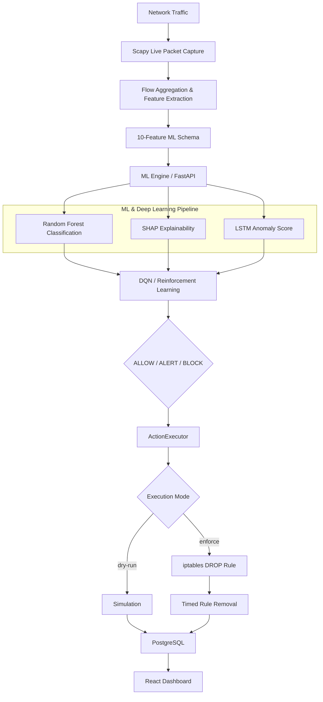

# XRL-IDARS: Explainable Reinforcement Learning Intrusion Detection & Autonomous Response System

## 1. Project Title
**XRL-IDARS:** Explainable Reinforcement Learning-Based Intrusion Detection and Autonomous Response System.

## 2. Project Overview
XRL-IDARS is a comprehensive, AI-driven cybersecurity pipeline designed for modern Security Operations Centers (SOC). It monitors local network traffic, detects malicious activity using Machine Learning (Random Forest) and Deep Learning (LSTM), explains the reasoning behind its detections transparently via Explainable AI (SHAP), and executes autonomous mitigation using Reinforcement Learning (DQN). 

## 3. Problem Statement
Traditional Intrusion Detection Systems (IDS) rely heavily on static signature matching, which fails against zero-day attacks. Modern ML-based solutions often operate as "black boxes", leading to a lack of trust from security analysts. Additionally, human intervention is typically required to mitigate detected attacks, increasing the response latency and risking greater damage.

## 4. Objectives
- **Detection**: Accurately classify benign and malicious network flows in real-time.
- **Explainability**: Provide human-readable, transparent insights (XAI) into why a model flagged a specific flow as malicious.
- **Autonomy**: Use Reinforcement Learning to determine the most effective mitigation action dynamically.
- **Observability**: Maintain a modern, responsive SOC dashboard providing real-time metrics and action execution history.

## 5. Proposed Solution
XRL-IDARS replaces traditional signature detection with a dual-stream ML/DL evaluation pipeline. Scapy is used to actively capture live network traffic and extract temporal flow features. These features are classified, explained, and mitigated autonomously. The resulting actions are intercepted, logged to PostgreSQL, and streamed via Server-Sent Events (SSE) to a React dashboard.

## 6. Key Features
- **Real-Time Packet Capture**: Natively aggregates TCP/UDP/ICMP traffic into 10-dimensional arrays via Python `scapy`.
- **Hybrid Inference Engine**: Employs both Random Forest and LSTM anomaly scoring.
- **XAI Waterfall Diagnostics**: Transparently details exact feature contributions using SHAP.
- **Autonomous DQN Agent**: Selects between ALLOW, ALERT, and BLOCK actions.
- **Action Execution Layer**: Includes a robust enforcement module containing IP protection, `dry-run` modes, and temporary `iptables` drop rules.
- **Live SOC Dashboard**: Features a React-based UI powered by a Node.js orchestration backend.

## 7. System Architecture



## 8. End-to-End Data Flow
1. **Network Interface** -> `scapy_sniffer.py` captures raw traffic and extracts features.
2. **Feature Payload** -> Sent via HTTP POST to the ML Engine (`/predict`).
3. **ML Engine** -> Transforms features -> Evaluates probabilities -> Determines RL action.
4. **Sniffer Worker** -> Forwards output to the Node.js API (`/api/db/events`).
5. **ActionExecutor** -> Validates safety rules, modifies OS-level firewall (if `enforce` mode), and maps the execution status.
6. **Node Backend** -> Persists the enriched event to PostgreSQL and streams it.
7. **Dashboard** -> Visualizes the SHAP arrays, risk scores, and autonomous mitigation logs.

## 9. ML/XAI/RL Pipeline
The machine learning pipeline consumes the following verified 10-feature schema:
1. `flow_duration_ms`
2. `flow_packets_per_s`
3. `flow_bytes_per_s`
4. `packet_length_mean`
5. `packet_length_std`
6. `syn_count`
7. `ack_count`
8. `rst_count`
9. `fin_count`
10. `syn_ack_ratio`

## 10. Autonomous Response Mechanism
The `ActionExecutor` processes the DQN decision dynamically. Supported action behavior:
- **ALLOW**: No firewall modification, recorded as `SUCCESS`.
- **ALERT**: No firewall modification, recorded as `SUCCESS`.
- **BLOCK**: Enacts `iptables` rules when enabled, drops packets for a temporary duration, and clears the rule automatically.

## 11. Safety Mechanisms
To prevent catastrophic accidental lockdowns, the system natively implements:
- IPv4/IPv6 format validation.
- Localhost/Loopback bypass protection.
- Active host interface isolation (blocks against self-IP are instantly rejected).
- `dry-run` default environment configuration.
- Auto-timed rule removals to prevent permanent deadlocks.
- Non-interactive `sudo -n` isolation.
- Read-only execution logging inside PostgreSQL.

## 12. Technology Stack
- **Frontend**: React 19, Vite, TailwindCSS, Lucide.
- **Backend**: Node.js, Express, TypeScript.
- **ML Engine**: Python 3.12, FastAPI, Scikit-Learn, PyTorch, SHAP, Numba.
- **Database/Storage**: PostgreSQL.
- **Network Tools**: Scapy, `arp-scan`, `iptables`.

## 13. Project Directory Structure
```
.
├── ml_engine/                # Python backend, ML models, FastAPI routing
│   ├── api/main.py           # FastAPI server
│   ├── artifacts/            # Pre-trained models (.joblib, .pt)
│   ├── models/               # PyTorch and SKLearn model definitions
│   └── explainability/       # SHAP integration
├── src/                      # React frontend and Node services
│   ├── components/           # UI Components (Dashboard, Firewalls, LAN)
│   └── services/             # ActionExecutor, ControlModule, Postgres DB
├── scapy_sniffer.py          # Real-time packet capture daemon
├── server.ts                 # Node.js Express server & REST API
├── package.json              # NPM Dependencies
├── PROJECT_PROGRESS.md       # Implementation tracking matrix
└── README.md                 # Project Documentation
```

## 14. API/Backend Components
**Node.js (Port 3000)**
- `GET /api/health` - Server status check.
- `GET /api/actions` - Retrieve historical autonomous actions.
- `POST /api/db/events` - Main entrypoint to process packet and trigger `ActionExecutor`.

## 15. ML Engine Components
**FastAPI (Port 8000)**
- `GET /health` - Model readiness evaluation.
- `POST /predict` - Synchronous ML evaluation (RF + SHAP + LSTM + DQN).

## 16. Scapy Live Capture
Implemented locally via `scapy_sniffer.py`. Features an asynchronous thread-pool capable of constructing BPF-filtered TCP/UDP flows dynamically on physical interfaces.

## 17. PostgreSQL Persistence
Schema includes the `security_events` table configured to persistently store comprehensive packet histories, including `dqn_action`, `execution_mode`, `execution_status`, `firewall_rule_id`, and `execution_error`.

## 18. React Dashboard
The frontend displays the live security pipeline via `RlDqnView`, showing a unified risk score alongside interactive visualization matrices separating `SIMULATED` vs `EXECUTED` decisions.

## 19. Installation/Setup
1. Install system dependencies: `sudo apt install arp-scan libpcap-dev postgresql`
2. Configure virtual environment: `python3 -m venv .venv`
3. Install backend dependencies: `npm install`
4. Install Python dependencies: `pip install -r ml_engine/requirements.txt`
5. Configure PostgreSQL `.env`.

## 20. Running the System
```bash
# Terminal 1: ML Engine
source .venv/bin/activate
uvicorn ml_engine.api.main:app --host 127.0.0.1 --port 8000

# Terminal 2: Node.js Orchestrator & Vite
npm run dev
```

## 21. Configuration
`ACTION_EXECUTION_MODE=dry-run` or `enforce`
`BLOCK_DURATION_SECONDS=60`

## 22. Testing/Verification
### Verified Real Firewall Test
A controlled autonomous firewall enforcement was successfully verified on this repository.
Setting `ACTION_EXECUTION_MODE=enforce`, an isolated `BLOCK` event was injected, successfully spawning a targeted `iptables DROP` rule (ID: `xrl-idars-timestamp`). PostgreSQL successfully recorded `dqn_action=BLOCK` and `execution_mode=enforce`. The internal timer successfully executed the auto-removal 60 seconds later.

### Dry-Run Test
While running live traffic (pings/curl) under `dry-run`, normal traffic resulted in `ALLOW` with `execution_status=SUCCESS`. Simulated blocks accurately aborted execution with `execution_status=SIMULATED` without altering actual network firewall chains.

## 23. Verified Results
- Scapy packet capture is natively functioning over the local interface.
- 10-feature schema is definitively integrated.
- Python ML models properly classify and calculate temporal variances.
- PostgreSQL comprehensively logs execution telemetry.

## 24. Current Limitations
- **OS Dependency**: System fundamentally relies on Linux network interfaces and routing architectures (`iptables`, `scapy`); Windows is not supported.
- **Root Permissions**: Scapy sniffing and `arp-scan` inherently require passwordless `sudo` escalation or rigid `setcap` setups.

## 25. Future Improvements
- Refactor the front-end components to retrieve firewall histories directly from PostgreSQL on application bootstrap rather than maintaining isolated UI states.
- Improve variable-length temporal sequences dynamically within the LSTM layer for enhanced granularity.

## 26. Project Status
The research implementation is functionally complete. The system was successfully designed, developed, integrated, and verified to meet final-year engineering project requirements.
